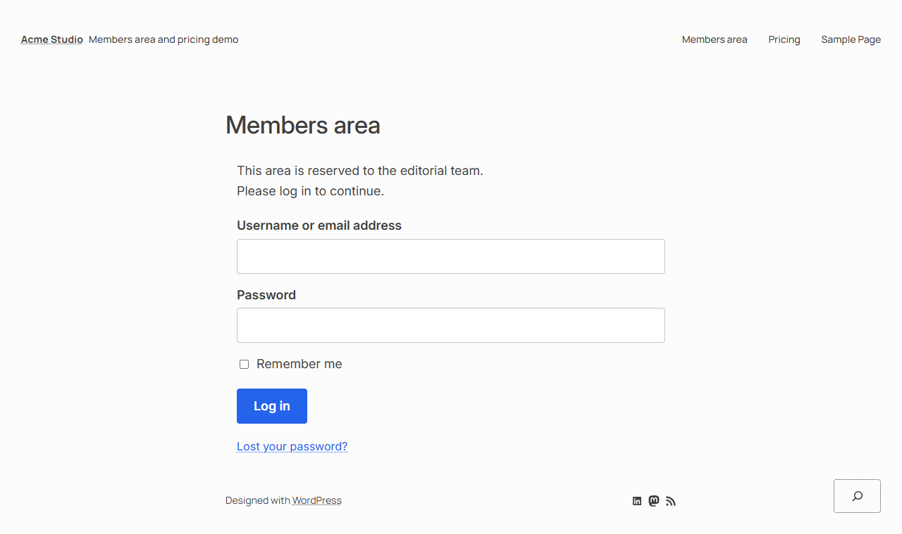
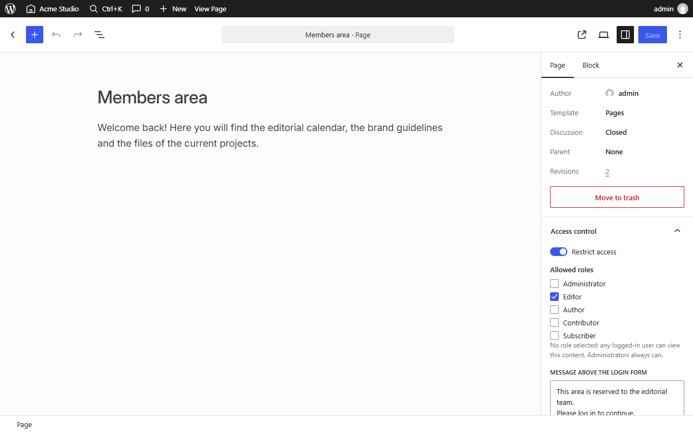
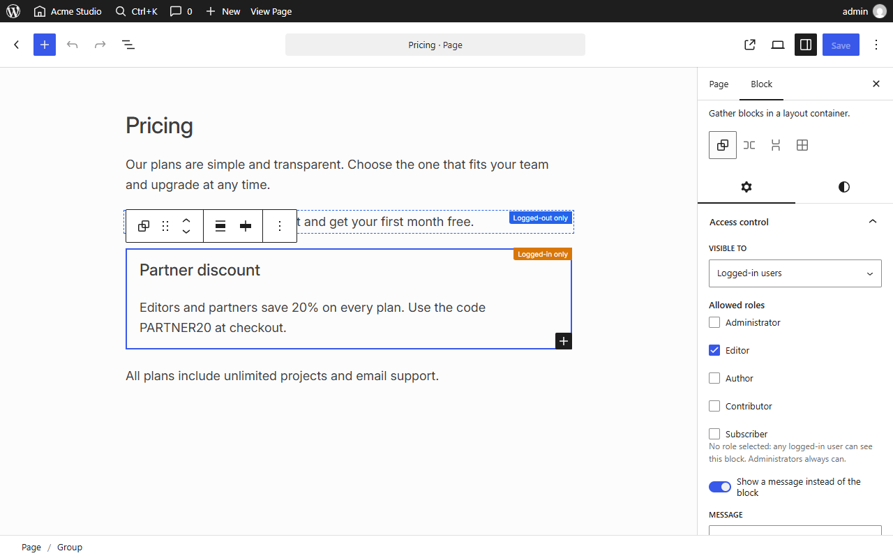
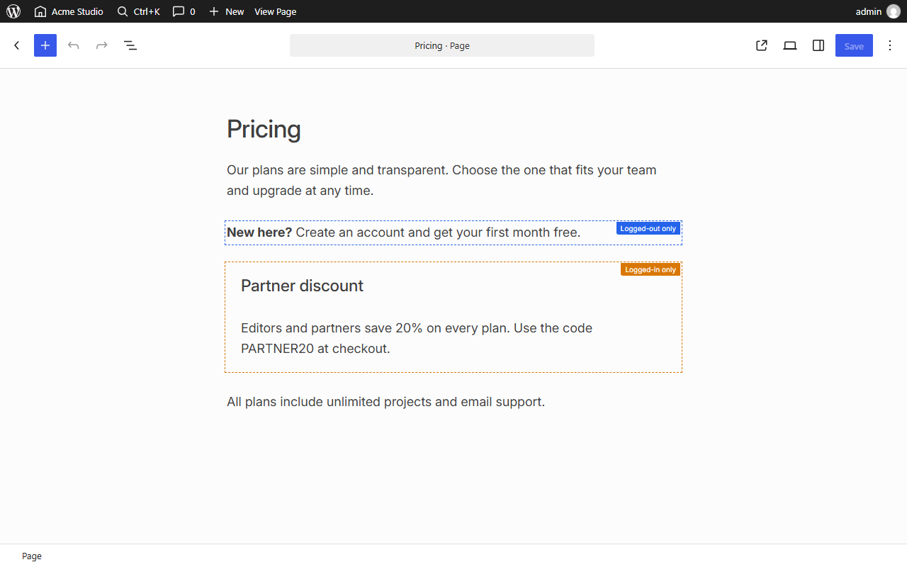
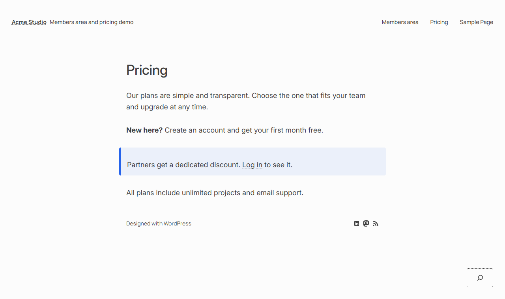
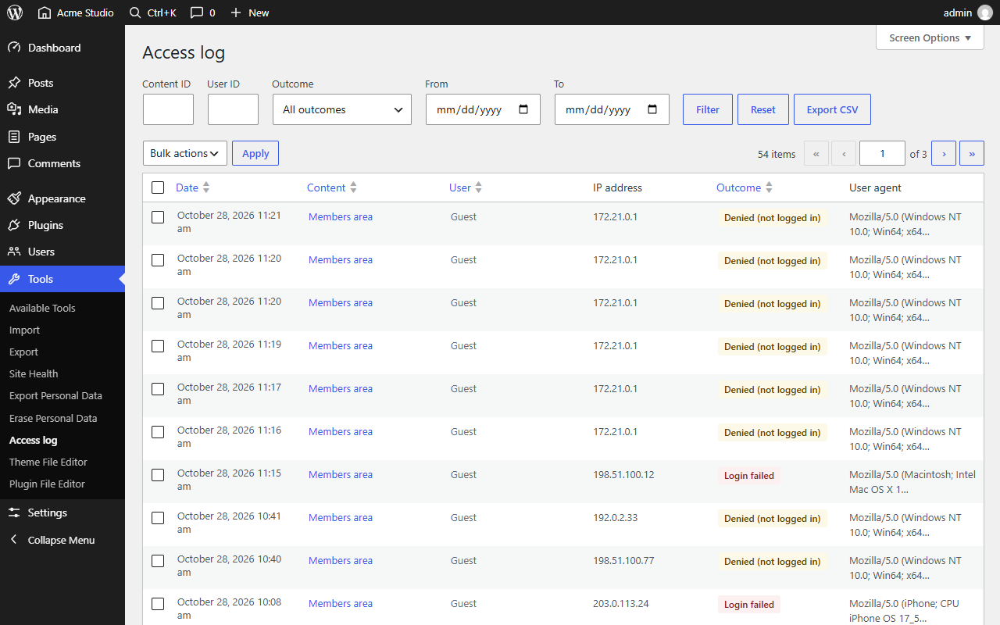
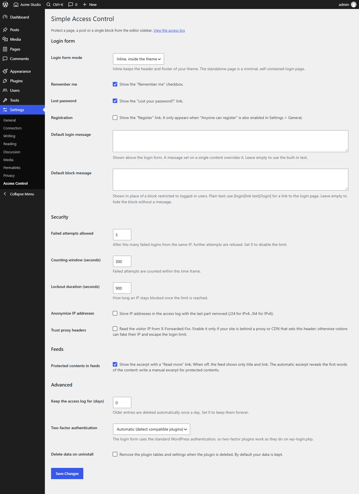
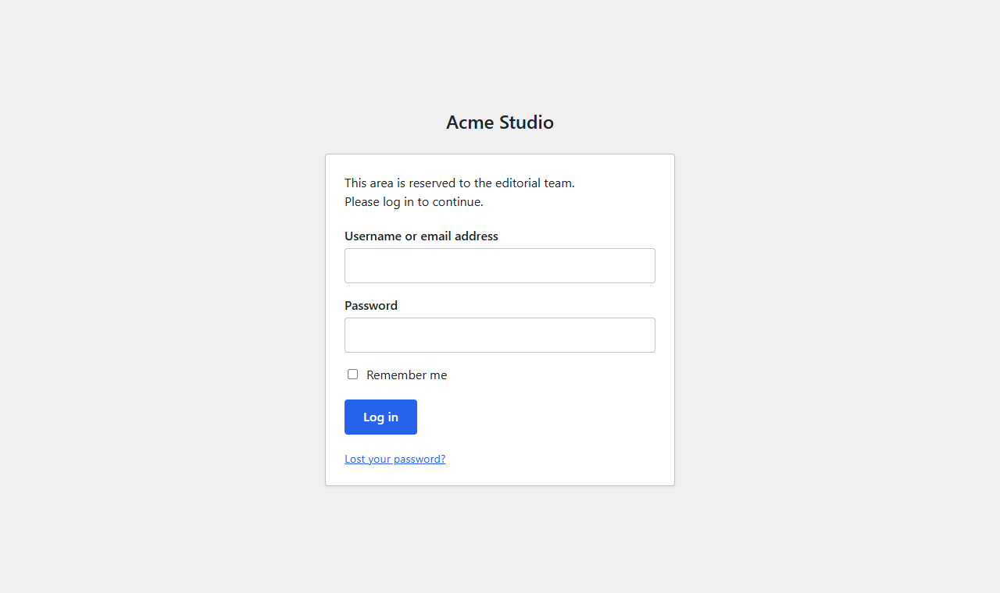

# WP Simple Access Control


Restrict access to **single contents** (pages, posts and any public custom post type) **and to single blocks** by user role. Visitors who are not allowed in see a styled login form instead, and every access is written to a log you can browse and export.



## Features

- **Content protection from the editor sidebar.** Turn protection on, pick the allowed roles and write an optional login message, all from the document panel of the block editor.
- **Block-level control.** Every block gets an "Access control" panel: show it to everyone, to logged-in users (optionally limited to some roles) or only to logged-out visitors. Wrap a section in a Group or Columns block to protect it as a whole.
- **Inline login form.** Rendered inside your theme (classic and block themes), or as a standalone minimal page. Overridable from your theme.
- **Not just the page.** Protected contents are also kept out of the REST API, feeds and archives.
- **Access log.** Who requested what, with which outcome, filterable, sortable, exportable as CSV, with optional retention and IP anonymization.
- **Login rate limiting** per IP, and compatibility with two-factor plugins.
- **Multisite ready.** Per-site tables, network activation, new sites and site deletion handled.
- **Translated.** English source strings, complete Italian translation included.

## Screenshots

| | |
|---|---|
|  **Document panel** in the block editor |  **Block panel** with the visibility indicator |
|  Restricted blocks are marked in the editor, without changing the layout |  What a logged-out visitor sees: the open block, and a message where the restricted one is |
|  **Access log** with filters, bulk delete and CSV export |  **Settings** page |

The standalone login mode:



## Requirements

- PHP 8.1 or higher
- WordPress 6.4 or higher

## Installation

**From a release zip.** Upload the plugin folder to `wp-content/plugins/` and activate it. The release must include the `vendor/` and `build/` folders.

**From the repository.**

```bash
git clone https://github.com/miziomon/wp-simple-access-control.git
cd wp-simple-access-control
composer install --no-dev --optimize-autoloader
npm install && npm run build
```

**With wp-env** (local development): see [Development](#development).

On activation the plugin creates its two tables (`wpsac_access_rules` and `wpsac_access_logs`) and keeps them up to date on plugin updates.

## Quick start

### Protect a whole content

1. Open a page or post in the editor and open the **Access control** panel in the document sidebar.
2. Turn on **Restrict access**.
3. Tick the roles that may view it. **No role ticked means any logged-in user.**
4. Optionally write a message to show above the login form. Update the content.

| Visitor | Content restricted to the `editor` role |
|---|---|
| Not logged in | Login form |
| Subscriber (logged in) | Login form, with a "not allowed" message |
| Editor | The content |
| Administrator | The content: administrators always get in |

The page answers with a `403` status and is never stored in a public cache.

### Protect a single block

Select any block and open **Access control** in the block sidebar.

| Visible to | Behavior |
|---|---|
| Everyone | No restriction (default) |
| Logged-in users | Only logged-in users. Tick roles to narrow it down; none ticked means any logged-in user. Administrators always see it |
| Logged-out visitors | Only visitors who are not logged in. **Administrators who are logged in do not see it** |

Turn on **Show a message instead of the block** to leave a note where the block would be. The message is plain text: write `[login]log in here[/login]` to turn part of it into a link to the login page. A default message for blocks restricted to logged-in users can be set in the settings.

To protect a whole section, put it inside a **Group** (or Columns/Column) and restrict that block: when it is hidden, nothing inside it is rendered.

## What is protected

| Surface | Behavior for a user who cannot view the content |
|---|---|
| The page itself | Login form, `403` |
| REST API, single item | `403` |
| REST API, collections | The item is left out of the results |
| Feeds | Only the excerpt and a "Read more" link |
| Archives and search (main loop) | Themes that print excerpts show the excerpt. Themes that print the full content show an excerpt plus a "reserved content" note |
| Automatic excerpts of restricted blocks | The restricted blocks are removed before the excerpt is built |

Users who can edit a content can still open it in the block editor through the REST API (the `edit` context), even when they are not among the allowed roles. Otherwise authors could not edit their own protected pages.

## Settings

Under **Settings > Access Control**:

| Setting | Default | |
|---|---|---|
| Login form mode | Inline | Inline inside the theme, or a standalone page |
| Remember me / Lost password / Registration | on / on / off | Which links the form shows. Registration also needs "Anyone can register" |
| Default login message | empty | Shown above the form; a message set on a content wins |
| Default block message | empty | Shown in place of blocks restricted to logged-in users |
| Failed attempts allowed | 5 | After this many failures from one IP the next attempt is refused. `0` disables the limit |
| Counting window / Lockout duration | 300 s / 900 s | |
| Anonymize IP addresses | off | Stores IPv4 as `/24` and IPv6 as `/64` |
| Trust proxy headers | off | Reads the IP from `X-Forwarded-For`. Enable it only behind a proxy or CDN you control |
| Protected contents in feeds | on | Excerpt plus link. When off, only title and link |
| Keep the access log for (days) | 0 | `0` keeps everything; otherwise a daily job removes older entries |
| Two-factor authentication | Automatic | |
| Delete data on uninstall | off | By default tables and settings are kept when the plugin is deleted |

## Access log

**Tools > Access log** lists every request to a protected content and every login attempt: date, content, user, IP address, outcome and user agent. Outcomes are `granted`, `denied (not logged in)`, `denied (wrong role)`, `login successful`, `login failed` and `login rate limited`.

You can filter by content, user, outcome and date range, sort by the main columns, delete entries in bulk and export the current filter as CSV. Cells that could be read as spreadsheet formulas are neutralized in the export.

Requests that hide or show a single *block* are not logged: that would mean one row per block at every page view. Use the `wpsac_block_hidden` action if you need it.

## Two-factor authentication

The login form signs the user in with the standard WordPress function, so two-factor plugins behave as they do on `wp-login.php`: after the password they ask for the second factor, then bring the user back to the protected content. This was tested with the [Two Factor](https://wordpress.org/plugins/two-factor/) plugin. A successful login is written to the log only once the second factor has been verified.

## Overriding the templates

Copy a file from the plugin's `templates/` folder to `wp-simple-access-control/` inside your theme (or child theme) and edit it:

| File | Purpose |
|---|---|
| `login-form.php` | The form shown instead of a protected content |
| `login-page.php` | The standalone page, used when the mode is "Standalone page" |

Each template documents the variables it receives in `$args`. The CSS classes follow BEM (`.wpsac-login`, `.wpsac-login-page`, `.wpsac-teaser`) and expose custom properties such as `--wpsac-accent` for quick restyling.

## Hooks

### Filters

| Hook | Purpose |
|---|---|
| `wpsac_supported_post_types` | Post types that can be protected (default: all public ones except attachments) |
| `wpsac_block_should_render` | `( bool $visible, array $block, string $mode )` Add your own criteria for blocks |
| `wpsac_block_teaser_html` | `( string $html, array $block, string $mode )` Change the message shown in place of a block |
| `wpsac_template_args` | `( array $args, string $name )` Data passed to a template |
| `wpsac_hide_protected_in_loops` | `( bool $hide )` Return `true` to remove protected contents from the main loop instead of showing an excerpt |
| `wpsac_logs_per_page` | `( int $per_page )` Rows per page in the access log (default 20) |
| `wpsac_twofa_active` | `( bool $detected )` Declare a two-factor plugin the plugin cannot detect |

### Actions

| Hook | Purpose |
|---|---|
| `wpsac_block_hidden` | `( array $block, string $mode )` A block was hidden from the current user |
| `wpsac_after_log` | `( AccessLogEntry $entry, int $id )` An entry was written to the access log |

```php
// Example: let users with a custom capability see restricted blocks.
add_filter( 'wpsac_block_should_render', function ( bool $visible, array $block, string $mode ): bool {
    return $visible || ( 'logged_in' === $mode && current_user_can( 'view_members_content' ) );
}, 10, 3 );
```

## Security notes and known limits

Protection is only as strong as the places it covers. Please read these.

- **Automatic excerpts show the first words.** If a protected content has no manual excerpt, archives, search and feeds show its first ~55 words (or all of it, when it is short). **Write a manual excerpt for protected contents.**
- **Search can reveal that a word exists.** WordPress searches inside the content, so a visitor can find out that a protected content contains a given word, even if they cannot read it.
- **Keep the markup of restricted blocks valid.** WordPress discards the attributes of a block whose comment JSON is malformed, and the block then becomes public. For users without the `unfiltered_html` capability, HTML inside a block attribute is stripped by WordPress and breaks that JSON. This is why the block message is plain text: do not put HTML into the attributes of restricted blocks.
- **Secondary loops are not covered.** Custom `WP_Query` loops, widgets and page builders that print contents outside the main loop do not go through the archive filter. Use `wpsac_hide_protected_in_loops` or check the rule yourself.
- **Themes that print the raw content bypass the archive and feed filters.** Themes and plugins must go through `the_content()` for the filters to apply. The protected page itself is not affected: on classic themes the login form replaces the whole template, and on block themes the content is replaced before the theme prints it.
- **Page caching.** Pages with restricted content send `Cache-Control: private, no-store`, `Vary: Cookie` and define `DONOTCACHEPAGE`. Make sure your page cache honors them. Restricted blocks inside synced patterns or template parts are detected at render time, after some headers may already be out.
- **IP address.** Behind a proxy or CDN enable "Trust proxy headers", otherwise every visitor shares the proxy IP and the login limit applies to all of them. Without a proxy leave it off: the header can be forged.
- **Logged-out blocks and administrators.** A block set to "Logged-out visitors" is hidden from every logged-in user, administrators included.

## Development

You need PHP 8.1+, Composer, Node 22+ and Docker (for `wp-env`).

```bash
composer install
npm install
npm run build              # builds the editor, frontend and admin assets
npm run start              # same, in watch mode
npx wp-env start           # WordPress at http://localhost:8888 (admin / password)
npx wp-env run cli wp ...  # run WP-CLI in the environment
```

Quality checks:

```bash
composer lint              # PHPCS (WordPress standards) + PHPStan level 6
npm run lint:js
npm run lint:css
```

### Multisite environment

```bash
npm run env:multisite -- start    # run it from the repository root; WordPress at http://localhost:8892
npm run env:multisite -- stop
```

### Translations

```bash
npm run i18n:pot    # extract the strings into languages/*.pot
npm run i18n:po     # merge them into the existing .po files
npm run i18n:mo     # compile .mo
npm run i18n:json   # JSON for the editor script (uses tools/i18n-map.json)
```

The source strings are in English. New editor files with translatable strings must be added to `tools/i18n-map.json`.

### Project layout

```
src/Domain          rules and the access decision (AccessPolicy)
src/Infrastructure  database schema, repositories, service container
src/Frontend        gate, login form, REST/feed/archive protection, cache headers
src/Blocks          per-block visibility, teaser, excerpt protection
src/Admin           editor panel, access log page, settings page
src/Security        IP resolution, login rate limiter, two-factor integration
src/Logging         log writer and retention
src/js, src/scss    editor scripts and styles (built with @wordpress/scripts)
templates           overridable templates
```

## Credits

The block-level control builds on the ideas of [wp-access-control-block](https://github.com/miziomon/wp-access-control-block), extended with roles and a few fixes: attributes registered on the server too, no wrapper element in the editor, and restricted wrapper blocks kept out of excerpts.

## Changelog

See [CHANGELOG.md](CHANGELOG.md).

## License

GPL-2.0-or-later. See [LICENSE](LICENSE).
